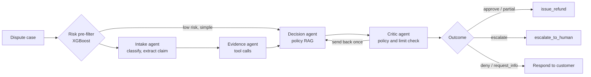

# DisputeDesk

**An agentic system for resolving customer disputes and refund requests, built to be measured, audited and governed.**

DisputeDesk handles two kinds of claims in one workflow: marketplace and delivery disputes (late, missing or
cancelled orders) and fintech disputes (unauthorized charges, duplicate charges, unrecognized transactions).
Each case is decided against written policy, using facts retrieved from tools, and ends in one of five
outcomes: `approve`, `partial`, `deny`, `escalate` (human approval) or `request_info`.

The project is organised around five production challenges of agentic AI. Each has a measurable target:

| Challenge | What is being built |
|---|---|
| **Orchestration** | LangGraph state machine with bounded retries, timeouts, async workers and graceful failure paths |
| **Observability** | OpenTelemetry and Langfuse trace for every LLM and tool call (tokens, cost, latency); replay from stored state |
| **Cost control** | Per-step cost tracking, small-model/large-model routing, policy-lookup caching, per-case budget cap and kill switch |
| **Evaluation** | Labelled golden set, behaviour checks, LLM-as-judge, pass^k consistency, regression thresholds that fail the build |
| **Governance** | Role-based tool permissions, human approval above a refund limit, guardrails, PII masking, immutable audit log, prompt-injection tests |

## Target architecture



Cross-cutting layers wrap every step: tracing, cost and budget enforcement, role-based tool
permissions, input/output guardrails, PII masking and an append-only audit log.

## Data

Real and synthetic data are kept apart: separate DuckDB schemas (`real`, `synthetic`, `derived`), and every
synthetic row carries `is_synthetic` and `scenario_type`.

| Source | Role | Notes |
|---|---|---|
| **CFPB Consumer Complaint Database** (real) | Fintech track: free-text complaints | Narratives come from the CC0 HuggingFace mirror [`BEE-spoke-data/consumer-finance-complaints`](https://huggingface.co/datasets/BEE-spoke-data/consumer-finance-complaints), because the CFPB API and bulk CSV expose no narratives. Covers 2022-01-01 to 2024-02-08. Card and money-transfer products only, 10,000 sampled per group. |
| **Olist Brazilian E-Commerce** (real) | Marketplace track: orders, payments, reviews, delivery timestamps | About 99,000 orders, 2016-2018. Licensed CC BY-NC-SA 4.0 (non-commercial); downloaded at setup, not redistributed here. Prices are BRL, converted to USD at a fixed 0.25. |
| **Synthetic layer** | Disputes, refund history, fintech transactions, policies | Seeded and reproducible. See below. |

### Synthetic layer

Olist contains no disputes and the CFPB data has no transaction records, so the claims are generated on top
of real facts:

- **Marketplace (1,460 disputes):** each is tied to a real Olist order chosen because its facts fit the
  scenario (for example, delivered 12 days late for under $100). Lateness, price, shipping fee, review score
  and seller history are real.
- **Fintech (500 disputes):** synthetic card and transfer transactions with IP and device identifiers,
  including near-miss cases for the Visa-style compelling-evidence rule.
- **Ground truth:** the written policies (`policies/`) applied to the facts by `rules.py`. Policy text and
  rules are generated from one set of constants, so they cannot drift apart. The generator fails if any
  scenario does not produce the outcome it was designed to test.
- **Point-in-time features:** a seller's failure rate and a customer's refund history use only information
  available before the dispute date, never later events.

The 25 scenarios cover clear approvals and denials, grace-period and on-time claims, over-limit claims,
missing and conflicting evidence, serial abusers, systemic seller failure, policy-precedence conflicts,
duplicate and unrecognized charges, and prompt injection.

### Golden evaluation set

`data/golden/` holds 180 synthetic cases (54 easy, 72 medium, 54 hard) and, in a separate file, 42 real CFPB
cases. Real and synthetic results are always reported separately. Each synthetic case records the expected
outcome and refund, the policies that apply, the tools the agent should call and the actions it must not take.

## Getting started

Requirements: Python 3.14, about 3 GB of free disk, and a free [Kaggle API token](https://www.kaggle.com/settings)
saved to `~/.kaggle/access_token`.

```bash
cp .env.example .env      # defaults are enough for the data pipeline
make setup                # virtualenv and pinned dependencies
make olist-download       # Olist (about 45 MB)
make cfpb-download        # CFPB mirror (about 925 MB), filtered
make cfpb-sample          # 10,000 complaints per product group
make load                 # build data/disputedesk.duckdb: real and derived tables
make synth                # policies, synthetic disputes, golden set
make dq                   # data-quality checks
make test
```

## Repository layout

```
policies/                    Generated policy documents (the source for policy RAG)
data/golden/                 Golden evaluation set (committed); raw/ and processed/ are gitignored
src/disputedesk/
  config.py                  Settings from environment / .env
  data/                      Download, sampling, loading, derived SQL, quality checks
  synthetic/                 Policies, rules (ground truth), generator, golden-set export
  tools/ rag/ risk/          Not yet implemented
  agents/ llm/               Not yet implemented
  observability/ governance/ Not yet implemented
tests/                       Rule, synthetic-data and config tests
```

## Design decisions

- **DuckDB for storage.** A single local file with the same SQL features needed here, so the project runs
  without a database server. Docker and Postgres are deferred to the final phase.
- **Policy as the single source of truth.** Thresholds live in one module; documents, ground truth and tests
  all read from it.
- **No look-ahead.** Features about sellers and customers are computed as of the dispute date.
- **Swappable LLM provider.** Gemini by default behind an interface, configured through environment variables.
  Secrets are never committed; see `.env.example`.

## Known limitations

- CFPB outcome labels are mapped from the company's own response, so they are self-reported proxies, not
  verified ground truth. Real CFPB cases are text-only: no order or transaction data stands behind them.
- Synthetic ground truth comes from this project's own policies. It measures policy-following, not real-world
  correctness.
- Complaint text is templated, with a few phrasings per claim type, so scores on synthetic cases are likely
  optimistic compared with natural language.
- The golden set's outcome mix is not even: `escalate` and `request_info` appear only in hard scenarios.
- The CFPB mirror ends in February 2024. The BRL to USD rate is a fixed simplification.
